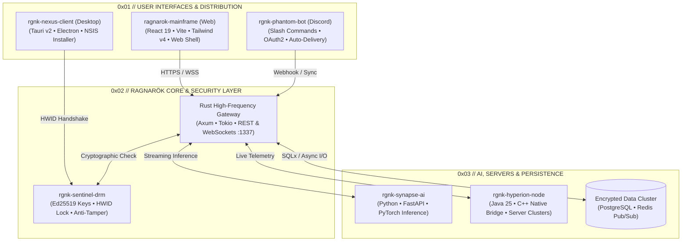

<div align="center">

  <!-- BANNIÈRE PRINCIPALE RAGNARÖK -->
  

  <br /><br />

  <!-- BADGES SYSTÈME DYNAMIQUES (PALETTE CYBER-TERMINAL) -->
  
  
  
  
  
  

</div>

<br />

```bash
root@ragnarok:~# ./ragnarok_mainframe --init --ring0 --deploy-all
[*] Booting Ragnarök Next-Gen Ecosystem v5.0 [Polyglot Cloud & Kernel Architecture]...
[+] Operator     : RAGNARÖK (0xRagnarok // ms.ragnarok) — Lead Systems & Full-Stack Architect
[+] Memory Base  : 0x7FF6A8B20000 -> [RING-0 PRIVILEGE ESCALATED // UID: 0]
[+] Core Stack   : Rust | TypeScript | React 19 | Python | Java 25 | C++ | C | C# | x64 ASM | NSIS
[+] Production   : Commercial SaaS Hub, DRM Licensing, Desktop Apps, AI Models, Discord Bots & APIs
[!] Firewall     : OVERRIDDEN — Zero-Trust Telemetry & WSS Tunnels Active [████████████] 100%
```

---

### `> 0x01 // CORE_ARSENAL & TECH_STACK`

#### `▸ [0x01.A] SYSTEMS, LOW-LEVEL & NATIVE ENGINEERING`
<div align="left">
  
  
  
  
  
  
  
</div>

#### `▸ [0x01.B] BACKEND, REAL-TIME WEBSOCKETS, APIs & AI MODELS`
<div align="left">
  
  
  
  
  
  
  
  
</div>

#### `▸ [0x01.C] WEB PLATFORM, GLASSMORPHIC DESKTOP & UI`
<div align="left">
  
  
  
  
  
  
  
  
</div>

#### `▸ [0x01.D] DATABASES, DEVOPS & ZERO-TRUST INFRASTRUCTURE`
<div align="left">
  
  
  
  
  
  
  
</div>

#### `▸ [0x01.E] PACKAGING, AUTOMATION & DISCORD ECOSYSTEM`
<div align="left">
  
  
  
  
  
  
</div>

---

### `> 0x02 // MAINFRAME_ARCHITECTURE & POLYGLOT_ENGINE`

```rust
// [0xRAGNAROK // MAINFRAME CORE SPECIFICATION v5.0]
pub mod ragnarok_ecosystem {
    pub struct MainframeConfig {
        pub central_hub:     &'static str, // "ragnarok-mainframe : Rust (Axum/Tokio) + React 19 + Tailwind v4"
        pub security_drm:    &'static str, // "rgnk-sentinel-drm  : Ed25519 Licensing, HWID Lock & Signed NSIS"
        pub desktop_launcher:&'static str, // "rgnk-nexus-client  : Tauri v2 / Electron Glassmorphic App Suite"
        pub neural_engine:   &'static str, // "rgnk-synapse-ai    : Python FastAPI, PyTorch Models & Agent APIs"
        pub discord_gateway: &'static str, // "rgnk-phantom-bot   : Automated License Delivery & OAuth2 Sync"
        pub server_cluster:  &'static str, // "rgnk-hyperion-node : Java 25 & C++ High-Tickrate Server Engine"
    }

    pub async fn execute_system_override() -> Result<(), &'static str> {
        sentinel_drm::enforce_zero_trust_ring0(0x7FF6A8B2)?;
        websocket_bus::bind_encrypted_stream("0.0.0.0:1337").await?;
        Ok(()) // [STATUS: ALL MODULES DEPLOYED & OPERATIONAL]
    }
}
```

#### `▸ [0x02.B] SYSTEM DATAFLOW & INFRASTRUCTURE TOPOLOGY`



---

### `> 0x03 // OPERATIONAL_DOMAINS & PRODUCT_MATRIX`

| ID | Division d'Ingénierie | Technologies Clés | Produits & Solutions Développés | Sécurité |
| :--- | :--- | :--- | :--- | :--- |
| **`0x01`** | **Web Platform & SaaS** | `Rust` `React 19` `TS` `Tailwind v4` | Marketplace centrale, dashboards temps réel, terminaux interactifs | `ZERO-TRUST // WSS` |
| **`0x02`** | **DRM & Native Packaging** | `Rust` `C++` `ASM` `NSIS` | Protection logicielle HWID, clés Ed25519, installateurs `.exe` signés | `RING-0 // ED25519` |
| **`0x03`** | **AI Models & Automation** | `Python` `PyTorch` `FastAPI` | Modèles d'IA sur mesure, agents autonomes, bots Discord et scrapers | `ENCRYPTED // API` |
| **`0x04`** | **Desktop & Server Cores** | `Tauri` `Electron` `Java 25` | Launchers desktop glassmorphic, serveurs distribués et plugins | `HWID // SANDBOXED` |

---

### `> 0x04 // NEXT-GEN_ECOSYSTEM & FLAGSHIP_REPOSITORIES`

| Nouveau Dépôt | Module | Stack Technique | Rôle dans l'Infrastructure `0xRagnarok` | Statut |
| :--- | :--- | :--- | :--- | :--- |
| **`ragnarok-mainframe`** | `0x01 // CORE` | `Rust` `Axum` `React 19` `Tailwind` | Infrastructure mère, store digital, API WebSockets et terminal web | `🟢 [ONLINE]` |
| **`rgnk-sentinel-drm`** | `0x02 // DRM` | `Rust` `C++` `Ed25519` `NSIS` | Gestionnaire de licences cryptographiques, HWID lock et compilateur NSIS | `🔴 [RING-0]` |
| **`rgnk-nexus-client`** | `0x03 // NEXUS` | `Tauri v2` `Electron` `TS` `React` | Application desktop dark-glass pour gérer, lancer et mettre à jour les outils | `🟢 [ONLINE]` |
| **`rgnk-synapse-ai`** | `0x04 // SYNAPSE` | `Python` `PyTorch` `FastAPI` | Serveur d'inférence IA haute vitesse, modèles custom et agents autonomes | `🟣 [NEURAL]` |
| **`rgnk-phantom-bot`** | `0x05 // PHANTOM` | `Python` `TS` `Discord API` | Bot et application Discord commerciale : livraison de clés et synchronisation | `🟢 [ONLINE]` |
| **`rgnk-hyperion-node`** | `0x06 // HYPERION` | `Java 25` `Rust` `C++` `Gradle` | Moteur de serveurs haute performance, plugins modulaires et télémétrie | `🟣 [ACTIVE]` |

---

### `> 0x05 // TELEMETRY_METRICS & SYSTEM_DIAGNOSTICS`

<div align="center">

  
  

  <br />

  

</div>

---

### `> 0x06 // CLASSIFIED_MODULES (EXPANDABLE_SPECS)`

<details>
<summary><b><code>[+] 0x06.A // DEVELOPMENT ENVIRONMENT (IntelliJ IDEA + Google Antigravity)</code></b></summary>
<br />

```ini
[WORKSPACE_ENVIRONMENT // 0xRAGNAROK]
Primary_IDE    = "IntelliJ IDEA Ultimate (Polyglot Monorepo Architecture)"
AI_Engine      = "Google Antigravity + Gemini 4 Hydrogen (xhigh Reasoning)"
Toolchains     = "Cargo (Rust), pnpm/Vite (TS/React), uv/Poetry (Python), Gradle (Java 25)"
Design_System  = "Dark Mode (#0D0B14), Glassmorphism, Neon Terminal Accents (#00FF66 / #FF2A4B)"
```
</details>

<details>
<summary><b><code>[+] 0x06.B // AUTOMATED BUILD PIPELINE & NSIS INSTALLER COMPILATION</code></b></summary>
<br />

```bash
# Pipeline de production automatisé du Monorepo 0xRagnarok
$ cargo build --release --workspace                       # Build ragnarok-mainframe & rgnk-sentinel-drm
$ pnpm --filter @rgnk/web-marketplace build               # Bundle React 19 + Vite + Tailwind CSS v4
$ pnpm --filter @rgnk/nexus-client tauri build            # Build du client desktop natif
$ ./gradlew :rgnk-hyperion-node:build                     # Compilation des modules serveurs Java 25
$ makensis /V4 ./installers/rgnk_setup.nsi                # Packaging de l'installateur Windows NSIS
```
</details>

<details>
<summary><b><code>[+] 0x06.C // ZERO-TRUST LICENSING & AUTOMATED DELIVERY PROTOCOL</code></b></summary>
<br />

* **Achat & Provisioning Instantané :** Lorsqu'un utilisateur acquiert une application, un script, un bot ou un accès API sur le site, `ragnarok-mainframe` génère une clé cryptographique `Ed25519` unique et synchronise automatiquement ses rôles Discord via `rgnk-phantom-bot`.
* **Vérification Matérielle (HWID Lock) :** Au lancement de l'installateur `NSIS` ou de l'application via `rgnk-nexus-client`, `rgnk-sentinel-drm` valide l'empreinte matérielle en quelques millisecondes via un tunnel WebSocket chiffré.
</details>

---

### `> 0x07 // ACTIVE_TRANSMISSIONS & ENCRYPTED_COMMS`

<div align="center">

  <a href="https://sys.override.net">
    
  </a>
  <a href="https://github.com/0xRagnarok">
    
  </a>
  
  

</div>

<br />

```text
╔══════════════════════════════════════════════════════════════════════════════════════════╗
║  root@ragnarok:~# echo "If it has memory, it can be rewritten."                          ║
║  [EOF // 0xRAGNAROK] — Next-Gen Software Ecosystem • Connection Encrypted (TLS 1.3) █    ║
╚══════════════════════════════════════════════════════════════════════════════════════════╝
```
