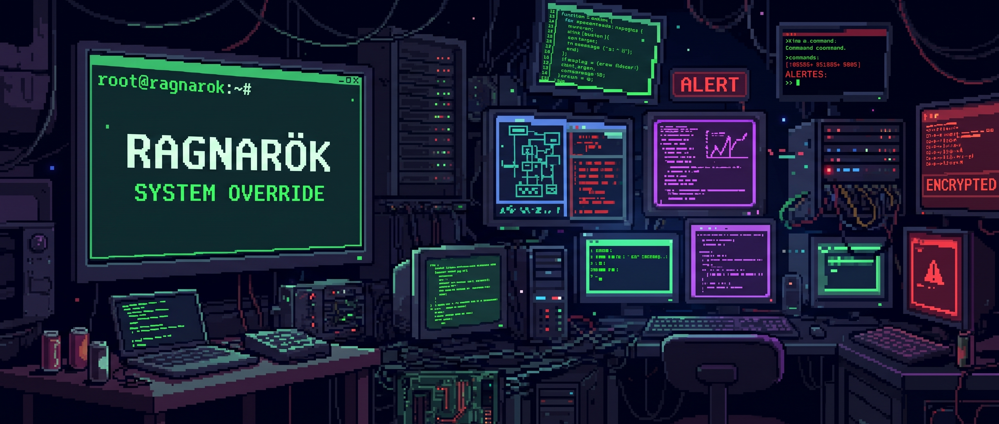

<!-- GitHub BIO (143 chars) :
▸ 0xRAGNAROK // Polyglot Ring-0 Architect (Rust · C++23 · Py · TS · Java 25). Telemetry HUD, APIs & Code Vault -> 0xRagnarok-Mainframe [RING-0]
-->
<div align="center">

<a href="https://github.com/0xRagnarok/0xRagnarok-Mainframe">
  
</a>

<br/><br/>


</div>

```text
root@ragnarok:~# ./ragnarok_mainframe --init --ring0 --deploy-all
[*] Booting Ragnarök Next-Gen Ecosystem [Polyglot Mainframe & Kernel Architecture]...
[+] Operator     : RAGNAROK (0xRagnarok // root@ragnarok:~#) - Lead Systems & Full-Stack Architect
[+] Memory Base  : 0x7FF6A8B20000 -> [RING-0 PRIVILEGE ESCALATED // UID: 0]
[+] Core Stack   : Rust | C++23 | C | Zig | x64 ASM | C# | TypeScript | React 19 | Python | Go | Java 25 | Lua | NSIS
[+] Flagship     : 0xRagnarok-Mainframe (Telemetry HUD, Marketplace, Ed25519 Code Vault & 9 Divisions)
[!] Firewall     : OVERRIDDEN - Zero-Trust Telemetry & WSS Tunnels Active [███████] 100%
```

---

## > 0x01 // CORE_ARSENAL & TECH_STACK

<details open>
<summary><b>▸ [0x01.A] SYSTEMS, RING-0 & LOW-LEVEL ENGINEERING</b></summary>
<br/>


</details>

<details open>
<summary><b>▸ [0x01.B] BACKEND, APIs, MICROSERVICES & REAL-TIME WEBSOCKETS</b></summary>
<br/>


</details>

<details open>
<summary><b>▸ [0x01.C] WEB PLATFORM, GLASSMORPHIC DESKTOP & UI</b></summary>
<br/>


</details>

<details open>
<summary><b>▸ [0x01.D] DATA SCIENCE, TELEMETRY, AI, QUANT & DATABASES</b></summary>
<br/>


</details>

<details open>
<summary><b>▸ [0x01.E] GAME ENGINES, PLUGINS, DEVOPS & PACKAGING</b></summary>
<br/>


</details>

---

## > 0x02 // MAINFRAME_ARCHITECTURE

```rust
// [0xRAGNAROK // 0xRagnarok-Mainframe SPECIFICATION]
pub mod ragnarok_mainframe {
    pub struct MainframeConfig {
        pub central_hub:      &'static str, // "01-core-mainframe : Rust (Axum) + React 19 + Tailwind v4"
        pub telemetry_ws:     &'static str, // "02-apis-and-websockets : High-Frequency WSS & Gateways"
        pub neural_quant:     &'static str, // "03-data-telemetry-and-ai : FastAPI, PyTorch & Quant"
        pub security_drm:     &'static str, // "04-ring0-systems-and-lowlevel : Ed25519 Vault & Native CLIs"
        pub automation_bots:  &'static str, // "05-bots-and-automation : Discord Bots & AI Agents"
        pub server_cluster:   &'static str, // "06-game-engines-and-plugins : Java 25, C++ SourceMod & Lua"
        pub desktop_saas:     &'static str, // "07-web-and-desktop-apps : Tauri v2, Electron & Kits"
        pub devops_ops:       &'static str, // "08-scripts-and-devops-tooling : PowerShell, Bash & Polyglot"
        pub release_forge:    &'static str, // "09-packaging-and-installers : NSIS, Docker & CI/CD"
    }

    pub async fn execute_system_override() -> Result<(), &'static str> {
        sentinel_drm::verify_ed25519_vault(0x7FF6A8B2)?;
        telemetry_bus::stream_wss("0.0.0.0:8080/ws/telemetry").await?;
        Ok(()) // [STATUS: 9/9 DIVISIONS OPERATIONAL]
    }
}
```

---

## > 0x03 // FLAGSHIP_MAINFRAME_DIVISIONS

<div align="center">

[](https://github.com/0xRagnarok/0xRagnarok-Mainframe)

</div>

| Code | Division | Stack & Role |
|---|---|---|
| `0x01` | [**Core Mainframe**](https://github.com/0xRagnarok/0xRagnarok-Mainframe/tree/main/01-core-mainframe) | React 19 + Tailwind v4 · Rust Axum Kernel · FastAPI Nexus · Tauri v2 |
| `0x02` | [**APIs & WebSockets**](https://github.com/0xRagnarok/0xRagnarok-Mainframe/tree/main/02-apis-and-websockets) | High-frequency WebSockets · REST / GraphQL / gRPC · Webhook relays |
| `0x03` | [**Data, Telemetry & AI**](https://github.com/0xRagnarok/0xRagnarok-Mainframe/tree/main/03-data-telemetry-and-ai) | PyTorch · Quant research · Network telemetry · Live metrics collectors |
| `0x04` | [**Ring-0 & Low-Level**](https://github.com/0xRagnarok/0xRagnarok-Mainframe/tree/main/04-ring0-systems-and-lowlevel) | Rust · C++23 · Zig · ASM · Ed25519 DRM Vault & native tools |
| `0x05` | [**Bots & Automation**](https://github.com/0xRagnarok/0xRagnarok-Mainframe/tree/main/05-bots-and-automation) | Discord bots · Autonomous AI agents · Scheduled daemons |
| `0x06` | [**Game Engines & Plugins**](https://github.com/0xRagnarok/0xRagnarok-Mainframe/tree/main/06-game-engines-and-plugins) | Java 25 (PaperMC 26.2 / NeoForge / JDA) · C++ SourceMod · CLEO / Lua |
| `0x07` | [**Web & Desktop Apps**](https://github.com/0xRagnarok/0xRagnarok-Mainframe/tree/main/07-web-and-desktop-apps) | Tauri / Electron studios · Glassmorphic templates · Micro-SaaS kits |
| `0x08` | [**Scripts & DevOps**](https://github.com/0xRagnarok/0xRagnarok-Mainframe/tree/main/08-scripts-and-devops-tooling) | PowerShell Windows Ops · Bash Linux hardening · Polyglot utility scripts |
| `0x09` | [**Packaging & Installers**](https://github.com/0xRagnarok/0xRagnarok-Mainframe/tree/main/09-packaging-and-installers) | Signed NSIS `.exe` installers · Docker Compose stacks · CI pipelines |

---

## > 0x04 // LIVE_TELEMETRY

<div align="center">


```text
root@ragnarok:~# exit
[ SESSION TERMINATED // RING-0 // ENCRYPTED ]
```

</div>
